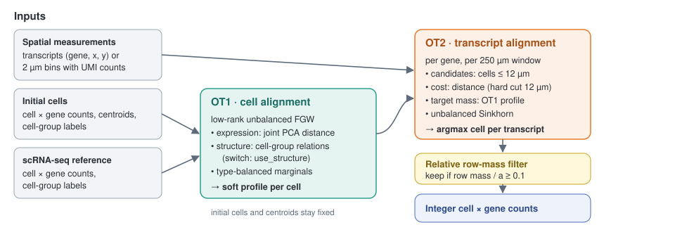

Welcome to tracel's documentation!
==================================

``tracel`` implements **Tracel**, a reference-guided method that assigns spatial transcriptomics
measurements to cells by two stages of optimal transport. It works with individually localized transcripts
from imaging-based platforms (Xenium, CosMx) and with UMI counts in subcellular bins from sequencing-based
platforms (Visium HD).

Instead of redrawing cell boundaries, Tracel asks *which cell produced each transcript*. In the first stage
(**OT1, cell alignment**), fused Gromov–Wasserstein transport aligns the initial spatial cells with a
tissue-matched single-cell RNA-seq reference and estimates the expected expression profile of every spatial
cell. In the second stage (**OT2, transcript alignment**), unbalanced optimal transport moves each transcript to
a nearby cell, using those profiles as the target distribution and the transcript-to-cell distance as the cost.
Assignments that carry too little transported mass are left unassigned, and the retained assignments form an
integer cell-by-gene count matrix.

   Tracel workflow. OT1 estimates a soft expression profile for each spatial cell from a scRNA-seq reference;
   OT2 reassigns transcripts (or weighted bin–gene records) to cells within 12 µm and keeps assignments
   whose relative row mass is at least 0.1.

For more details, please check out our :doc:`installation guide <install>` and
:doc:`tutorials <tutorials>`. The manuscript is in preparation.

.. toctree::
   :maxdepth: 2
   :caption: Contents:

   install
   tutorials
   data
   api
   cli
   release
   dev
   credits

Indices and tables
==================

* :ref:`genindex`
* :ref:`modindex`
* :ref:`search`
